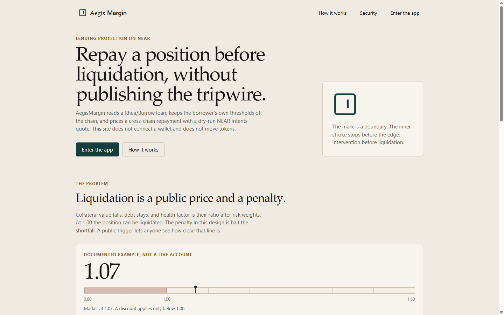
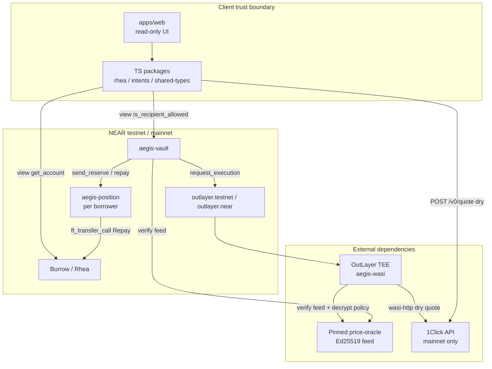
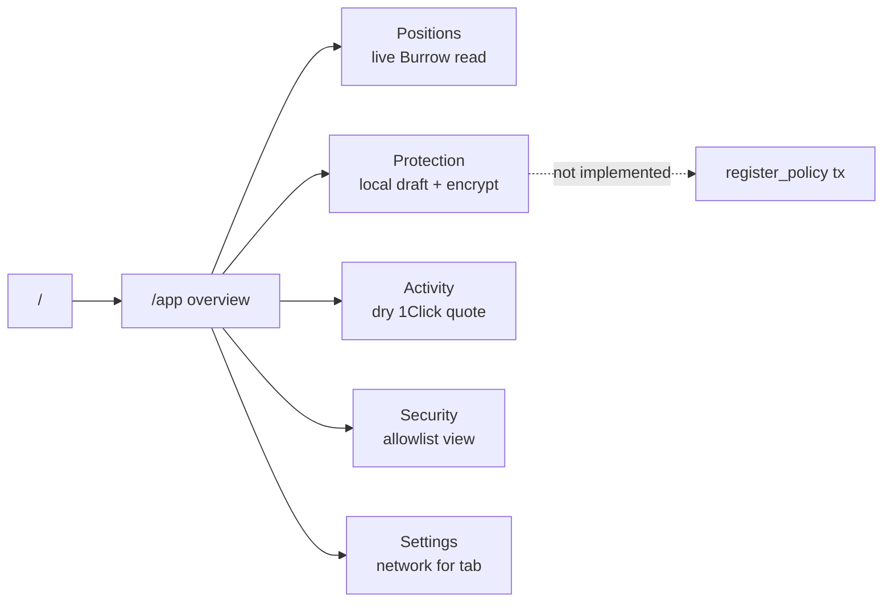
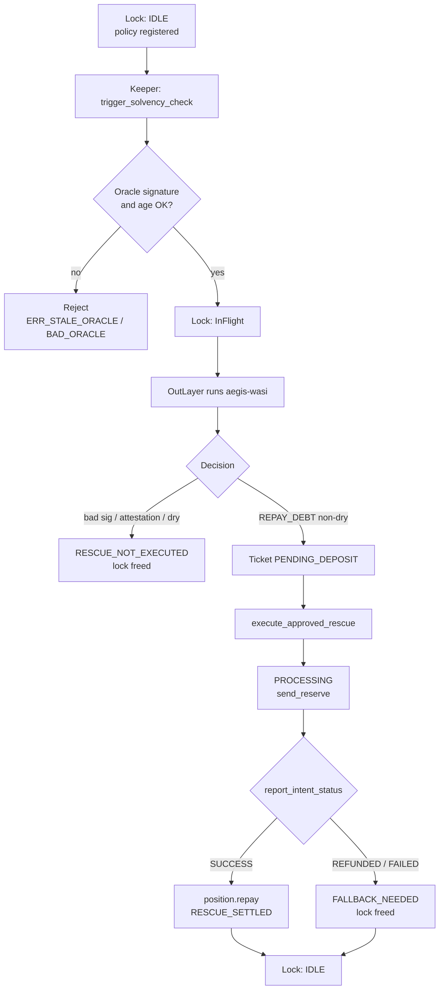
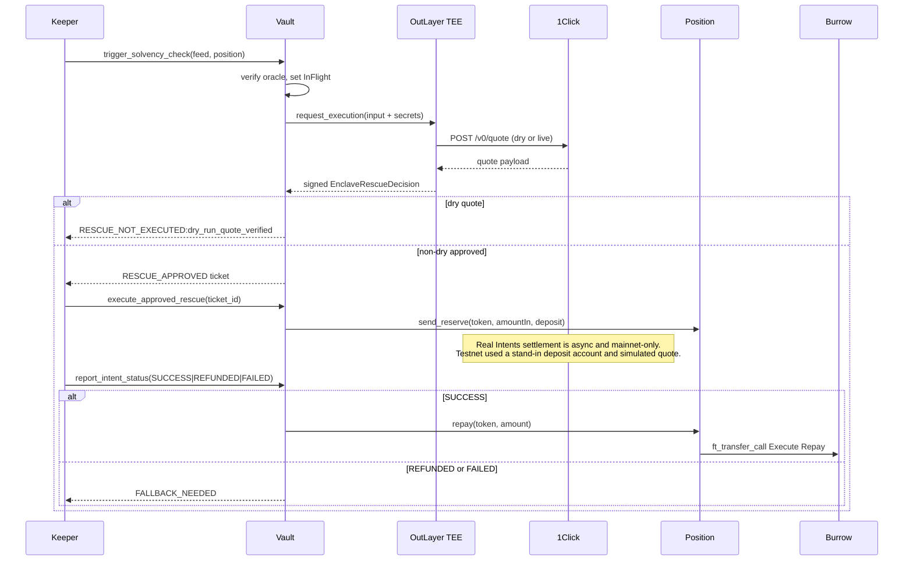
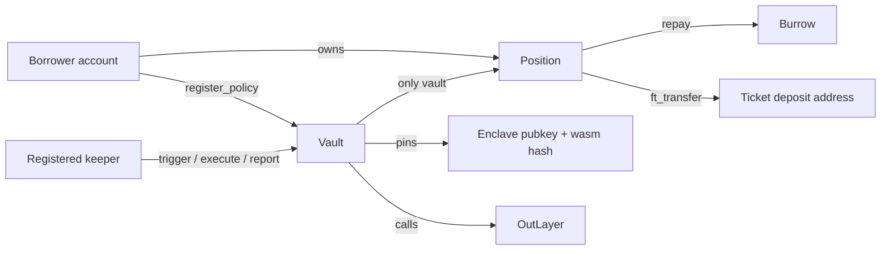
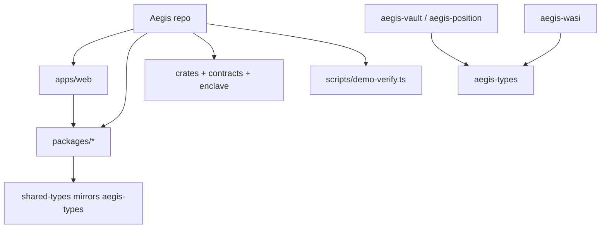

# AegisMargin

Confidential repayment protection for Rhea/Burrow loans on NEAR. Borrowers store encrypted solvency thresholds on chain. A registered keeper can ask an OutLayer TEE program to evaluate health and size a repayment. Settlement is intended through NEAR Intents 1Click, with the vault enforcing allowlists, oracle signatures, and enclave attestation before any funds move.

**Status:** Hackathon prototype on NEAR testnet. Dry-run quotes, vault verification, and a simulated non-dry execute path have been demonstrated. Real cross-chain settlement and real Burrow debt reduction are not shown yet. The web app is read-only: it does not connect a wallet or submit transactions.



| Resource | Location |
|---|---|
| Repository | [github.com/dcablorh/Aegis](https://github.com/dcablorh/Aegis) |
| License | [MIT](LICENSE) |
| Contract and enclave notes | [contracts/README.md](contracts/README.md) |
| Verification report (2026-11-10) | [docs/VERIFICATION_REPORT.md](docs/VERIFICATION_REPORT.md) |
| Architecture decisions | [docs/ARCHITECTURE.md](docs/ARCHITECTURE.md) |
| Developer brain dump | [brain/](brain/) |

## Table of contents

1. [Overview](#overview)
2. [Core concepts](#core-concepts)
3. [How AegisMargin works](#how-aegismargin-works)
4. [System architecture](#system-architecture)
5. [Technology stack](#technology-stack)
6. [Repository structure](#repository-structure)
7. [Prerequisites](#prerequisites)
8. [Installation and setup](#installation-and-setup)
9. [Environment configuration](#environment-configuration)
10. [Running the project](#running-the-project)
11. [Testing](#testing)
12. [Security architecture](#security-architecture)
13. [Financial mechanism and risk](#financial-mechanism-and-risk)
14. [Supported networks and integrations](#supported-networks-and-integrations)
15. [Current implementation status](#current-implementation-status)
16. [Limitations and known issues](#limitations-and-known-issues)
17. [Roadmap](#roadmap)
18. [Contributing](#contributing)
19. [License](#license)
20. [Acknowledgements and references](#acknowledgements-and-references)

---

## Overview

AegisMargin is protocol-adjacent infrastructure for borrowers who hold a leveraged position on Rhea Finance / Burrow and want automated repayment protection without publishing their trigger levels in plaintext on chain.

### Who it is for

- Borrowers who want a private health-factor trigger and a bounded repayment target.
- Keepers who run solvency checks with a function-call key, not full account control.
- Reviewers and hackathon judges who need a reproducible path from source to testnet evidence.

### The problem

On a lending market, a position is solvent while adjusted collateral covers adjusted debt. When collateral prices fall or debt grows, health factor falls. Below the liquidation threshold, liquidators can seize collateral at a discount.

Public stop levels are easy to front-run. Fully custodial bots require trusting a third party with keys and parameters. Cross-chain repayment (for example sourcing USDC on Base and settling USDC on NEAR) is asynchronous: quote, deposit, bridge, and repay are separate stages that can fail independently.

### How AegisMargin approaches it

1. The borrower encrypts a policy (minimum and target health factors, max slippage, salt) to an X25519 key held by the enclave. Only a SHA-256 commitment and ciphertext are stored on the vault.
2. A keeper submits a signed price feed and a position snapshot. The vault verifies the oracle signature and age, locks the borrower, and calls OutLayer.
3. The enclave decrypts the policy, checks the commitment, computes health and repayment size, requests a 1Click quote (live dry quote in the current OutLayer deployment), and signs a decision.
4. The vault verifies the enclave Ed25519 signature and wasm attestation hash. A dry quote is rejected for execution. A non-dry quote becomes a one-shot ticket.
5. The keeper executes the ticket: the borrower's position contract sends reserve tokens only to the deposit address named in that signed ticket. Later, the keeper reports intent status; success triggers a Burrow repay from the same position account.

### What makes the architecture interesting

- **Confidential thresholds** with an on-chain commitment so a swapped ciphertext is detectable.
- **Attested destination**: temporary swap deposit addresses are not on the static allowlist; they are allowed only inside a live ticket signed by the pinned enclave key.
- **Separated gas budgets**: trigger, execute, and settle are distinct calls. The lock stays set until a terminal outcome.
- **Honest dry-run boundary**: NEAR Intents has no testnet. Live quotes with `dry: true` are price checks. The vault refuses to execute them.

---

## Core concepts

### Collateral, debt, and health factor

Amounts are valued in micro-USD (`1_000_000` = `$1`). Ratios are basis points (`10_000` = 1.0). The same integer maths live in `enclave/aegis-wasi/src/math.rs` and `packages/rhea-client/src/math.ts`.

For each asset:

$$
V = \frac{\text{amount}_{\text{raw}} \times \text{price}_{\text{micro-usd}}}{10^{\text{decimals}}}
$$

Adjusted collateral and borrow:

$$
C_{\text{adj}} = \sum V_c \times \frac{w_c}{10{,}000}, \quad B_{\text{adj}} = \sum V_b \times \frac{10{,}000}{w_b}
$$

where $w$ is Burrow's `volatility_ratio` in basis points.

Health factor:

$$
\text{HF}_{\text{bps}} = \frac{C_{\text{adj}} \times 10{,}000}{B_{\text{adj}}}
$$

Example used throughout tests and the judge script: 1000 wrap.testnet at `$4.28` with weight 6000 bps versus 2400 USDC debt at `$1.00` with weight 10000 bps yields $\text{HF} = 1.07$ (10700 bps).

### Liquidation threshold and risk

When $\text{HF} < 1.0$, the position is liquidatable under this model. Rhea's liquidation discount used in the enclave is:

$$
d_{\text{bps}} = \frac{10{,}000 - \text{HF}_{\text{bps}}}{2} \quad (\text{zero when } \text{HF} \ge 1)
$$

`penalty_saved_bps` assumes a further 20% collateral drop before rescue (`STRESS_DROP_BPS = 2000`) and measures the discount avoided under that stress. It is a documented assumption for quote comparison, not a live market measurement.

### Automated protection

A **policy** holds `hf_min_bps`, `hf_target_bps`, `max_slippage_bps`, and a salt. Commitment:

```text
sha256("aegis-policy-v1" || u32be(hf_min) || u32be(hf_target) || u32be(max_slippage) || salt)
```

The enclave trigger floor is also bounded by a volatility buffer:

$$
\text{HF}_{\text{trigger}} = \max(\text{hf}_{\text{min}},\; 1.02 + 2.33 \times \sigma\sqrt{\tau})
$$

with $\tau = 45$ seconds settlement assumption (`BASE_TRIGGER_BPS`, `K_X100`, `SETTLE_SECONDS` in the enclave).

### Cross-chain liquidity

NEAR Intents 1Click returns a quote with `amountIn`, `minAmountIn`, `amountOut`, and a deposit address. Expected spread uses `minAmountIn` (or falls back to `amountIn`). Worst-case spread uses `amountIn`, which already includes the slippage buffer. There is no Intents testnet; production settlement is mainnet-only.

### Confidential execution and verification

OutLayer runs the WASI enclave in a TEE. Secrets (policy decryption key, signing seed, oracle pubkey, attestation hash, recipient, refund) are stored in OutLayer profiles, not in this repository. The vault pins the enclave public key and expected wasm SHA-256 and verifies every decision before creating a ticket.

---

## How AegisMargin works

### Lifecycle (implemented vs planned)

| Step | Status |
|---|---|
| 1. Wallet connection in the web app | Planned (not implemented) |
| 2. Lending position discovery (Burrow `get_account` via RPC) | Implemented (read-only UI + `rhea-client`) |
| 3. Continuous position monitoring | Planned (keeper-driven today; no UI monitor loop) |
| 4. Protection configuration (local encrypt + commitment) | Implemented locally; on-chain `register_policy` not wired in UI |
| 5. Trigger evaluation (`trigger_solvency_check` + enclave) | Implemented on testnet |
| 6. Liquidity sourcing (1Click quote) | Live dry quotes from enclave and web; non-dry testnet path uses a labelled simulated quote |
| 7. Cross-chain execution | Not shown for real Intents; testnet execute moves fake USDC to a stand-in deposit account |
| 8. Destination settlement | Simulated on testnet via `report_intent_status(SUCCESS)` |
| 9. Burrow repayment from position account | Contract path implemented; real debt drop not shown (testnet oracle prices missing) |
| 10. Final position verification | Ticket state + lock freed; live Burrow HF often unavailable on testnet |

### Asynchronous execution

Cross-chain repayment is not one atomic transaction.

1. **Request:** vault locks borrower and calls OutLayer.
2. **Quote / decide:** enclave signs a decision (may be dry).
3. **Approve:** vault creates a ticket only for non-dry, attested quotes.
4. **Deposit:** `execute_approved_rescue` moves reserve to the ticket deposit address.
5. **Off-chain / bridge processing:** Intents lifecycle (`PENDING_DEPOSIT` → `PROCESSING` → terminal).
6. **Report:** `report_intent_status` with `SUCCESS`, `REFUNDED`, or `FAILED`.
7. **Repay or fallback:** success calls `position.repay`; refund/fail frees the lock and logs `FALLBACK_NEEDED`.

Timeouts, refunds, and failed quotes leave funds on the position account or refund path. They do not silently unlock a second concurrent rescue while `InFlight`.

### Quick user path that works today (web)

1. Open the landing page and enter the app.
2. Read a Burrow account under Positions (health only when prices and debt exist).
3. Prepare a local policy under Protection (not submitted).
4. Request a dry 1Click quote under Activity.
5. Check allowlist answers under Security.

---

## System architecture

### Components

| Component | Responsibility | Inputs | Outputs | Dependencies |
|---|---|---|---|---|
| `apps/web` | Read-only product UI | Account ids, draft forms | Local drafts, dry quotes, views | Vite, React, workspace packages |
| `packages/rhea-client` | Burrow RPC views and HF maths | Account id, network | Account, optional HF | NEAR RPC, Burrow |
| `packages/intents-client` | 1Click quote/status helpers | Quote request | Labelled quote payload | `https://1click.chaindefuser.com` |
| `packages/shared-types` | Commitment, encrypt, decision signing bytes | Policy plaintext | Hex/base64 payloads | `@noble/*` |
| `crates/aegis-types` | Shared Rust schema | Same domain types | Borsh/JSON types, signing message | `near-account-id`, `sha2` |
| `contracts/aegis-vault` | Policies, keepers, locks, tickets, OutLayer call | Keeper txs, oracle feed | Events, promises | OutLayer, oracle key, enclave pin |
| `contracts/aegis-position` | Vault-only `send_reserve` / `repay`; owner `withdraw` | Vault calls | FT transfers | Burrow, NEP-141 tokens |
| `enclave/aegis-wasi` | Decrypt policy, HF, quote, sign decision | stdin JSON + env secrets | stdout JSON decision | OutLayer TEE, 1Click (when live) |

### High-level system architecture



### User journey (current web app)



### Protection lifecycle



### Cross-chain execution sequence (target path; testnet substitutes noted)



### Component interaction (on-chain)



---

## Technology stack

| Technology | Purpose | Implementation status |
|---|---|---|
| Rust / near-sdk 5.x | Vault and position contracts | Implemented |
| Rust WASI (`aegis-wasi`) | Confidential decision program | Implemented; deployed to OutLayer as wasm32-wasip2 |
| TypeScript 5.6 / pnpm workspaces | Shared clients and web app | Implemented |
| React 19 + Vite 6 + react-router 7 | Product UI | Implemented (read-only) |
| NEAR Protocol (testnet primary) | Settlement and storage | Testnet deployment verified |
| OutLayer | TEE execution | Testnet project verified |
| NEAR Intents 1Click | Quotes / intended settlement | Live dry quotes; no real mainnet settlement in repo evidence |
| Rhea / Burrow | Lending venue | Reads live; repay path coded; debt drop not shown on testnet |
| price-oracle style Ed25519 feeds | Trigger pricing | Verified in vault/enclave; testnet Burrow market oracle returns no usable prices |
| `@noble/hashes` / `curves` / `ciphers` | Browser commitment and X25519+ChaCha20-Poly1305 | Implemented |
| Vercel (`apps/web/vercel.json`) | SPA rewrites for static host | Config present; hosting is operator-controlled |

Solidity, Foundry, Hardhat, and Tailwind are not used.

---

## Repository structure

```text
Aegis/
├── apps/web/                 # Vite React UI (landing + /app shell)
├── packages/
│   ├── shared-types/         # Policy commitment, encrypt, decision bytes
│   ├── rhea-client/          # Burrow views + HF maths
│   └── intents-client/       # 1Click quote and status helpers
├── crates/aegis-types/       # Shared Rust domain types
├── contracts/
│   ├── aegis-vault/          # Policy store, rescue orchestration
│   ├── aegis-position/       # Per-borrower position sub-account
│   └── README.md             # Workstream A commands
├── enclave/aegis-wasi/       # OutLayer TEE program + testnet_kit example
├── scripts/demo-verify.ts    # Judge-facing live checks
├── docs/                     # Architecture + verification report
├── brain/                    # Dev notes (STATUS may lag addresses)
├── .env.example              # Optional 1Click + enclave secret names
├── Cargo.toml                # Rust workspace
├── package.json              # pnpm scripts
└── LICENSE                   # MIT
```



---

## Prerequisites

Verified on developer machines and in [docs/VERIFICATION_REPORT.md](docs/VERIFICATION_REPORT.md):

| Requirement | Notes |
|---|---|
| Node.js 22+ | Local check used v22.20.0 |
| pnpm 10+ | Local check used 10.28.2 |
| Rust stable | Local toolchain rustc 1.96.1; docs mention 1.95+ / 1.99.x in places |
| `wasm32-unknown-unknown` | Contract builds |
| `wasm32-wasip1` and/or `wasm32-wasip2` | Enclave builds; OutLayer deploy used wasip2 |
| Network access | NEAR RPC, optional 1Click HTTP |
| Windows extras | `AWS_LC_SYS_NO_ASM=1`, clang, and often cmake for `aws-lc-sys` (see `brain/SETUP.md`) |

Wallet: a **NEAR** wallet (for example MyNearWallet) is required for on-chain `register_policy` and keeper calls. The current web UI does not integrate a wallet. MetaMask is not used for these NEAR transactions.

---

## Installation and setup

```bash
git clone https://github.com/dcablorh/Aegis.git
cd Aegis
pnpm install
```

`pnpm install` links the TypeScript workspace (`pnpm-workspace.yaml`: `packages/*`, `apps/*`).

Optional env file:

```bash
cp .env.example .env
```

Leave `ONECLICK_*` blank to use the public 1Click fee. Never commit real enclave seeds.

Build TypeScript packages and the web app:

```bash
pnpm build
```

Build NEAR contracts (when the Rust toolchain is ready):

```bash
cargo build -p aegis-vault -p aegis-position --target wasm32-unknown-unknown --release
```

Build the enclave (target depends on your OutLayer pipeline):

```bash
cargo build -p aegis-wasi --target wasm32-wasip2 --release
```

---

## Environment configuration

From [`.env.example`](.env.example). Values are names only; secrets stay out of git.

| Variable | Purpose | Required | Example / placeholder |
|---|---|---|---|
| `ONECLICK_API_KEY` | Optional partner fee reduction | No | empty |
| `ONECLICK_JWT` | Optional partner auth | No | empty |
| `AEGIS_POLICY_SECRET_HEX` | X25519 secret to open policies (OutLayer) | OutLayer only | 64 hex chars |
| `AEGIS_SIGNING_KEY_HEX` | Ed25519 seed for decisions (OutLayer) | OutLayer only | 64 hex chars |
| `AEGIS_ORACLE_PUBKEY` | Pinned oracle `ed25519:...` | OutLayer / vault pin | `ed25519:...` |
| `AEGIS_ATTESTATION_SHA256` | Expected enclave wasm hash | OutLayer / vault pin | 64 hex chars |
| `AEGIS_RECIPIENT` | Quote recipient account | OutLayer | position or intents placeholder |
| `AEGIS_REFUND_TO` | Origin-chain refund address | OutLayer | EVM or NEAR address |
| `AEGIS_LIVE` | `1` requests non-dry quotes | OutLayer | `0` |
| `AEGIS_QUOTE_FIXTURE` | Offline quote file path | Offline enclave runs | path string |

Web app addresses are compile-time constants in [`apps/web/src/config.ts`](apps/web/src/config.ts), not env vars.

---

## Running the project

### Frontend

```bash
pnpm dev
```

Serves Vite at `http://localhost:5173`. Routes: `/` landing; `/app/*` shell; legacy `/protection`, `/quote`, `/security` redirect into the app.

Production-style preview after build:

```bash
pnpm --filter @aegis/web build
# then from apps/web: npx vite preview
```

Vercel: set project root to `apps/web`, output `dist`. SPA rewrites are in `apps/web/vercel.json`.

### Judge / smoke script

```bash
pnpm demo:verify
```

Builds required packages, reads the sample Burrow account, checks documented HF maths, requests a live dry 1Click quote, and asserts `evil.near` is blocked on the vault allowlist.

### Contracts and enclave

There is no local blockchain package in-repo. Use `cargo test` / `cargo build` as in [contracts/README.md](contracts/README.md). Testnet operations use `near-cli` / OutLayer CLI outside this README's automated scripts. Helper encoding for the current stack:

```bash
cargo run -p aegis-wasi --example testnet_kit -- keys|policy|trigger|quote
```

### Services that must run together

| Goal | Need |
|---|---|
| Browse UI | `pnpm dev` only (public RPC + 1Click) |
| `demo:verify` | Network to NEAR testnet RPC + 1Click |
| Full rescue | Deployed vault, position, OutLayer project, keeper account, configured secrets |

---

## Testing

### TypeScript (verified in this workspace)

```bash
pnpm test
```

Covers `shared-types`, `rhea-client`, and `intents-client` Node tests, plus `tsc --noEmit` for the web app. Recent local run: **20 package tests passed**, web typecheck passed.

### Judge script (verified in this workspace)

```bash
pnpm demo:verify
```

Recent local run printed a live dry quote and confirmed the allowlist block. Sample account showed collateral 0 / debt 0; documented HF 1.07 / repay 345.60 USDC is labelled as the example, not that account.

### Rust (documented; local Windows run may need cmake)

```bash
cargo test --workspace --lib --tests
```

[docs/VERIFICATION_REPORT.md](docs/VERIFICATION_REPORT.md) records **95** Rust tests passing on Linux (types 7, position 7, vault 36+12+2, enclave 31). Attack simulation:

```bash
cargo test -p aegis-vault --test security_attack_sim -- --nocapture
```

Invariant suite:

```bash
cargo test -p aegis-vault --test invariant_tests
```

This Windows environment failed `cargo test` while building `aws-lc-sys` (`Missing dependency: cmake`). That is a local toolchain gap, not a reported test failure on Linux.

### Web build (verified)

```bash
pnpm --filter @aegis/web build
```

Completes `tsc` and Vite production build.

There is no separate frontend unit-test runner beyond TypeScript checking.

---

## Security architecture

### Implemented controls

- **Invariant 1:** vault stores commitment + ciphertext only (`register_policy`).
- **Invariant 2:** static recipient allowlist: borrower, mapped position, Burrow, Ref, `intents.near`. View: `is_recipient_allowed`.
- **Attested exception:** during an `InFlight` ticket, `send_reserve` may target the deposit account embedded in the enclave-signed ticket (`assert_attested_recipient`).
- **Keeper authorization:** only registered keepers call `trigger_solvency_check`, `execute_approved_rescue`, `report_intent_status`.
- **Oracle:** pinned key, Ed25519 over payload bytes, max age 60s (`MAX_ORACLE_AGE_NS`).
- **Enclave:** Ed25519 decision signature over `aegis-decision-v1` length-prefixed fields; wasm attestation hash must match.
- **Dry-run guard:** `ERR_DRY_RUN_QUOTE_CANNOT_EXECUTE`.
- **Single flight:** lock `InFlight` blocks concurrent rescues; ticket execute-once.
- **Intent transitions:** `IntentLifecycleState::can_transition_to` enforces allowed status moves.
- **Position isolation:** only the vault may `send_reserve` / `repay`; owner may `withdraw`.
- **UI surface:** no wallet; cannot accidentally submit from the demo UI.

### Security assumptions

- OutLayer TEE and secret storage behave as documented by OutLayer.
- The pinned oracle key is the correct feed for trigger decisions.
- Keepers are semi-trusted for liveness, not for destination choice.
- Borrowers correctly encrypt to the current enclave X25519 pubkey.
- 1Click solvers and bridges are external trust.

### Known limitations

- Not audited.
- TEE execution does not by itself prove privacy against a compromised enclave operator model beyond OutLayer's guarantees.
- Testnet execute used a **simulated** non-dry quote and stand-in deposit account.
- Keeper in the recorded testnet run was the owner account (convenience), not a dedicated function-call-key keeper.
- Web does not yet submit `register_policy`, so end users cannot complete onboarding from the UI alone.

### Future security improvements (not claimed done)

- Dedicated keeper keys with least privilege.
- Mainnet Intents settlement with tiny amounts under explicit human approval.
- Continuous monitoring and alerting outside manual keeper calls.
- External audit.

---

## Financial mechanism and risk

| Question | Current answer in this repo |
|---|---|
| What triggers protection? | Enclave compares observed HF to policy / volatility trigger; returns `REPAY_DEBT` or none. |
| Where does liquidity come from? | Intended: origin asset via 1Click. Testnet evidence: fake USDC already on the position account. |
| If liquidity cannot be sourced? | Quote errors abort decision; dry quotes never execute; refund/fail frees lock and logs fallback. |
| If settlement is delayed? | Lock remains until terminal report; no second rescue concurrently. |
| If the position becomes liquidatable mid-flight? | Not eliminated. Async windows are real. Stress buffer tries to act earlier; it is not a guarantee. |
| Who pays gas? | Keeper/owner attach deposit/gas on vault calls; OutLayer execution consumes attached deposit. |
| How do users authorize? | On-chain `register_policy` by borrower; position owner withdraw; vault owner admin. UI does not sign yet. |
| If execution fails? | `REFUNDED`/`FAILED` → lock idle + `FALLBACK_NEEDED` (manual Ref path noted in code comments). |

Open design points: production fee sponsorship, automated local fallback swap, and mainnet inventory management for origin assets.

---

## Supported networks and integrations

| Network or protocol | Role | Status | Documentation |
|---|---|---|---|
| NEAR testnet | Contracts, OutLayer, demo accounts | Active throwaway stack `aegis-cloud-319903.testnet` | [docs/VERIFICATION_REPORT.md](docs/VERIFICATION_REPORT.md) |
| NEAR mainnet | Intents settlement venue | Not exercised for rescue in evidence | [docs.near.org](https://docs.near.org/) |
| Burrow testnet `contract.1638481328.burrow.testnet` | Lending reads / repay target | Reads live; borrows blocked by missing oracle prices | Rhea/Burrow docs |
| Burrow mainnet `contract.main.burrow.near` | Constants present in client | Not used in verified rescue demo | |
| NEAR Intents 1Click | Quotes | Live `dry: true`; no testnet | [docs.near-intents.org](https://docs.near-intents.org/) |
| OutLayer testnet | TEE host | Project `aegis-cloud-319903.testnet/aegis` verified | [OutLayer NEAR integration](https://app.outlayer.ai/docs/near-integration) |
| Ref Finance | Allowlisted recipient / future local fallback | Allowlisted; fallback not automated | |
| price-oracle.testnet / Burrow `priceoracle.testnet` | Feeds | Vault uses signed feed API; Burrow market prices currently unusable on testnet | |

### Current testnet addresses (from `apps/web/src/config.ts` and verification report)

| Piece | Account / value |
|---|---|
| Vault | `vault.aegis-cloud-319903.testnet` |
| Borrower | `borrower1.aegis-cloud-319903.testnet` |
| Position | `position1.aegis-cloud-319903.testnet` |
| Swap deposit stand-in | `swapdeposit.aegis-cloud-319903.testnet` |
| Policy X25519 public key | `31ba381a065a1501238c72b3668fe5b1aecd29074797800b0689bfe8be42b45e` |
| Enclave wasm sha256 (reported) | `6323745e22be396983072e0bab46e673b559db5f6e17836f0d83fd19aec0d050` |

Older account families in `brain/STATUS.md` (`aegis-vault-dev1`, `aegis-enclave-dev1`) are historical. Prefer the verification report and `config.ts`.

---

## Current implementation status

| Feature | Status | Notes |
|---|---|---|
| Wallet connection | Planned | No wallet adapter in `apps/web` |
| Position discovery | Implemented | Live Burrow `get_account` |
| Health factor display | Partial | Only when oracle prices and debt exist; testnet often withheld |
| Protection draft + encrypt | Implemented | Local session only |
| `register_policy` from UI | Planned | Contract method exists |
| Keeper trigger | Implemented | On-chain + OutLayer |
| Enclave decision | Implemented | Live dry quote from TEE verified |
| Dry 1Click quote (web + enclave) | Implemented | Labelled; `depositAddress` `dry_run` |
| Non-dry Intents settlement | Not shown | Testnet used simulated quote |
| `execute_approved_rescue` | Implemented | Verified with fake USDC move |
| `report_intent_status` + repay path | Implemented | Settled on testnet; real debt drop not shown |
| Allowlist UI | Implemented | Matches vault views |
| Continuous monitoring UI | Planned | |
| Mainnet rescue | Planned | Needs explicit human approval for funds |
| Audit | Not done | |

---

## Limitations and known issues

1. **No real cross-chain swap in evidence.** Intents is mainnet-only; testnet non-dry path was simulated and labelled.
2. **No real Burrow debt reduction on testnet.** `priceoracle.testnet` returns no usable prices; borrows fail with missing asset price.
3. **Web cannot complete protection onboarding** without a separate signing path for `register_policy`.
4. **Position snapshot in recorded enclave runs** used the documented example feed when live debt/prices were unavailable. Signature and age checks still applied.
5. **`brain/STATUS.md` lags** newer addresses; treat it as a journal, not the address source of truth.
6. **Windows Rust builds** may require clang, `AWS_LC_SYS_NO_ASM=1`, and cmake.
7. **Hackathon packaging** (public demo video, X post, submission JSON) is outside this repository's automated scope and needs the human owner.

---

## Roadmap

Realistic next steps, not commitments:

1. Wire NEAR wallet signing for `register_policy` and clear UX for ciphertext submission.
2. Dedicated keeper account with function-call access only.
3. Optional tiny mainnet dry-to-live path under explicit approval.
4. Mock or alternate Burrow price feed on testnet if a public debt-drop demo is required without mainnet.
5. Automate or document Ref local fallback after `FALLBACK_NEEDED`.
6. Keep `shared-types` and `aegis-types` in lockstep when schemas change.

---

## Contributing

1. Fork or clone the repository.
2. Create a topic branch from current `main` (or the active integration branch your team agrees on).
3. Prefer small, reviewable commits. Match existing conventional style (`feat:`, `fix:`, `docs:`).
4. Run `pnpm test` and, when possible, `pnpm demo:verify` and `cargo test --workspace --lib --tests` before opening a PR.
5. Do not commit `.env`, OutLayer seeds, or private keys.
6. Do not push force to `main`. Do not spend mainnet funds without explicit human approval.
7. Open a PR against the agreed base branch and describe what was verified.

Coding standards: integer bps maths (no floating point in protocol maths), label dry quotes clearly, keep Rust and TypeScript type mirrors synchronized.

---

## License

[MIT](LICENSE). Copyright (c) 2026 AegisMargin contributors.

---

## Acknowledgements and references

- [NEAR Protocol documentation](https://docs.near.org/)
- [NEAR Intents / 1Click](https://docs.near-intents.org/)
- [OutLayer NEAR integration](https://app.outlayer.ai/docs/near-integration)
- Rhea Finance / Burrow lending markets
- [NEAR HACKATHON](https://nearhackathon.com/) context preserved in [`NEAR_HACKATHON_PROJECT_CONTEXT.md`](NEAR_HACKATHON_PROJECT_CONTEXT.md)
- Cryptographic primitives via Rust crates and `@noble/*` in TypeScript

No partnership or endorsement beyond ordinary use of public protocols and tools is claimed.
